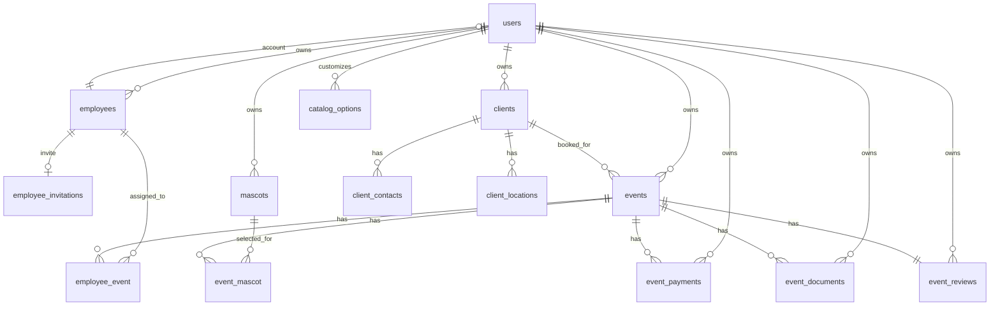

# Your Business Planner - schema proiect

Actualizat: 2026-10-20

## Organizare si repository - 2026-10-20

Backendul este in `business-api`, iar frontendul in `business-front`. Caile din documentatie, regulile proiectului, `.gitignore` si numele backendului din lockfile-ul npm folosesc noile directoare. Configuratiile GitHub Actions mostenite au fost eliminate, impreuna cu regula lor de export din `.gitattributes`. Copia nu contine istoric Git, remote-uri sau submodule si nu este conectata la un repository GitHub. Initializarea Git si asocierea noului repository raman pentru alegerea destinatiei.

## Copie initiala - 2026-10-20

Proiect separat in `D:\projects\your-business-planner`, pornit din codul local GT Events 1.20. Pastreaza backendul Laravel in `business-api` si frontendul React Native in `business-front`, cu aceleasi dependinte, contracte API, migrari, ecrane si fluxuri de business.

Numele afisat al aplicatiei este `Your Business Planner`; Android `applicationId` si iOS `PRODUCT_BUNDLE_IDENTIFIER` sunt `com.yourbusinessplanner`. Versiunea initiala este `0.1.0`, build `1`. Numele tehnice interne `GTEventsApp`, namespace-ul Android `com.gteventsapp` si prefixele de configurare/comenzi existente raman pentru continuitatea copiei. Semnarea release foloseste variabilele separate `YBP_UPLOAD_*`; certificatul de productie GT Events nu este copiat.

Configuratia locala foloseste API-ul pe portul `8010`, baza MySQL separata `your_business_planner` si o cheie Laravel noua. Nu s-au copiat mediile de productie, bazele de date, fisierele incarcate, logurile, cache-urile, dependintele instalate sau istoricul Git. Nu s-au rulat migrari, instalari de dependinte, builduri sau verificarile periodice. Initializarea ulterioara este descrisa in `README.md`.

Documentatia de mai jos este baza tehnica mostenita din GT Events. Sectiunile despre lansari, hosting, domenii, configurari Google si extensia `gt-bebe-widget` descriu proiectul sursa; nu reprezinta infrastructura noului proiect. Extensia widget nu face parte din aceasta copie. Identitatea vizuala, textele specifice domeniului si functionalitatile existente vor fi adaptate in taskurile urmatoare.

Documentul descrie structura curenta pentru `business-api` si `business-front`.

Revizia 1.20 adauga prelungirea la incasarea integrala: intrebare implicita `Nu`, durata, tarif client pe animator, selectarea participantilor si total calculat. Castigul pentru prelungire foloseste tarifele snapshot; participantii cu tarif zero impart numai restul prelungirilor la care au participat.

Release Android 1.20 foloseste `versionCode 21` si acelasi certificat ca 1.19. Migrarea de prelungire a fost aplicata in productia `gatify_api` la 2026-10-19 si inregistrata in lotul 14, dupa copierea tabelelor `event_payments` si `migrations`. Cache-ul rutelor a fost curatat. Artifactele, hash-ul si nota de deploy sunt in `release-artifacts/`, sub numele `GT-Events-v1.20`.

Revizia 1.19 normalizeaza in model data evenimentului la `Y-m-d`, inclusiv pentru valori cu ora sau `DateTimeInterface`, astfel incat comparatiile directe pe coloana `date` sa respecte filtrele aceleiasi zile si trecerea in istoric si pe SQLite. Nu necesita schimbarea schemei sau migrare pe MySQL.

## Arhitectura

- `business-api`: Laravel API, Sanctum token auth, baza relationala.
- `business-front`: React Native app, consumator API prin `src/shared/api/client.ts`.
- `gt-bebe-widget`: extensie Android instalabila separat (`com.gt.bebe`), fara dependenta runtime de `business-front` sau `business-api`; afiseaza varsta estimata a sarcinii pe ecranul principal al telefonului.
- Toate datele operationale sunt scoped pe `users.id`.
- Conturile admin se creeaza cu `php artisan gt:user-create`; conturile angajatilor se creeaza doar din invitatie.
- Calendarul din mobile foloseste `react-native-calendars@^1.1314.0`.
- Uploadul de documente in mobile foloseste `@react-native-documents/picker`.
- Reminder-ele locale pentru completarea platii folosesc `@notifee/react-native`.
- Fiecare eveniment primeste si reminder-e locale inainte de start, cu 24h, 6h si 1h, plus un reminder la o ora dupa final pentru plata si nota; sunt programate dintr-un singur loc (`EventRemindersSync`) pentru evenimentele din urmatoarele 30 de zile, se anuleaza pentru evenimentele anulate sau cu termenul depasit, iar apasarea notificarii deschide ecranul evenimentului.
- Review-urile noi sunt livrate prin notificari locale numai adminului: aplicatia interogheaza periodic coada persistenta din API si confirma livrarea dupa afisare; apasarea notificarii deschide evenimentul recenziei.
- Formularele modale avertizeaza la inchidere cand au modificari nesalvate, iar continutul fiecarui tab se remonteaza cu starea implicita dupa parasirea lui.
- Concernele transversale din mobile stau la nivel de aplicatie: sesiunea expirata este tratata de clientul React Query (`queryCache`/`mutationCache`), erorile neasteptate trec prin `shared/monitoring/reportError`, cele aratate utilizatorului prin `shared/feedback/showError`, iar confirmarile distructive prin `shared/feedback/confirmAction`.
- Cheile de cache si politica de invalidare sunt centralizate in `shared/api/queryKeys` si `shared/api/queryInvalidation`.
- Listele de evenimente, agenda adminului si listele de clienti se incarca paginat (`useInfiniteQuery`, 20 pe pagina); calendarul incarca doar luna vizibila. Totalurile lunare ale agendei adminului vin din backend si includ toate evenimentele viitoare active, independent de paginile incarcate.
- Tokenul mobil este pastrat exclusiv in Keychain (`react-native-keychain`). O valoare legacy din `AsyncStorage.authToken` este migrata o singura data si apoi stearsa; daca Keychain esueaza, aplicatia nu pastreaza tokenul necriptat. Logout-ul scrie temporar doar un marker nesensibil pana cand stergerea securizata reuseste.
- Requesturile mobile au timeout de 20 secunde, suporta anulare, ascund raspunsurile HTML ale infrastructurii si valideaza runtime raspunsurile API cu Zod. React Query primeste explicit starea de focus din `AppState` si starea online din NetInfo.
- Endpointurile de lista folosesc paginare Laravel standard si accepta `page` + `per_page`.
- Recenziile clientilor se completeaza dintr-o pagina web publica servita de `business-api` (`/review/{token}`), deschisa din linkul trimis pe WhatsApp; numele echipei afisat acolo vine din `GT_COMPANY_NAME` (`config/gt.php`).

## Locatie confirmata pe harta - 2026-10-08

Locatia si adresa text ale rezervarii raman independente de destinatia confirmata. Numai adminul deschide selectorul din pagina evenimentului, cauta un loc sau o adresa prin Google Places UI Kit Basic Autocomplete, ajusteaza pinul prin atingere sau mutarea markerului si apasa explicit `Confirma locatia`. Inchiderea paginii nu salveaza nimic. Selectorul nu apare la creare sau in formularul de editare.

`events` primeste `map_place_id` (string nullable), `map_latitude` si `map_longitude` (decimal 10,7 nullable, exclusiv pentru pin manual), `map_confirmed_at` (timestamp nullable). Campurile nu sunt mass-assignable in endpointurile generale ale rezervarii. Pentru o selectie Google se pastreaza numai ID-ul; coordonatele sunt rezolvate temporar, fara cache persistent, si nu sunt expuse in resursa evenimentului. Pentru un pin manual se pastreaza perechea de coordonate. Mutarea unui marker Google il transforma intr-un pin manual.

Resursele adminului si angajatilor asignati includ optional `map_location`:

```json
{"kind":"google_place","place_id":"ChIJ...","latitude":null,"longitude":null,"confirmed":true,"confirmed_at":"2026-10-08T15:00:00+03:00"}
```

```json
{"kind":"manual_pin","place_id":null,"latitude":47.0465,"longitude":21.9189,"confirmed":true,"confirmed_at":"2026-10-08T15:00:00+03:00"}
```

Fara pin, `map_location` este `null`. La modificarea efectiva a `location` sau `address`, punctul se pastreaza ca propunere, `confirmed` devine `false` si `confirmed_at` devine `null`. Modificarile altor campuri nu anuleaza confirmarea. Cardurile Home admin, Agenda angajat si detaliile ambelor roluri afiseaza `Deschide Google Maps` numai pentru puncte confirmate. URL-ul HTTPS Google Maps foloseste coordonatele exacte sau `query_place_id` si poate deschide aplicatia Maps ori browserul, fara a porni automat traseul. Actiunea este separata de apasarea pe corpul cardului.

In detaliile evenimentului pentru admin, `Trimite detaliile rezervării` apare in interiorul cardului cu sumarul rezervarii, dupa randurile de detalii, cu aceleasi reguli de disponibilitate. Actiunile hartii sunt grupate intr-un card separat cu titlul `Locație`: deschiderea Google Maps pentru un punct confirmat, stabilirea sau modificarea locatiei si stergerea pinului existent. Butonul de stabilire/modificare foloseste acelasi fundal roz deschis si text/iconita roz inchis ca butonul Maps. `Șterge pinul` foloseste varianta distructiva `danger`, cu iconita `trash-outline`, si pastreaza confirmarea inainte de stergere.

| Endpoint | Rol si rezultat |
| --- | --- |
| `POST /api/events/{id}/map-selector` | Admin proprietar; `{url, location_revision}`. URL semnat pe 10 minute, fara token mobil; amprenta SHA-256 a localitatii/adresei |
| `GET /event-map-picker/{user}/{event}?expires=...&signature=...` | Pagina HTTPS cu semnatura valida, admin activ si ownership reverificat; fara date personale |
| `POST /api/events/{id}/map-resolve` | Admin proprietar; body exclusiv `{place_id}` sau `{latitude, longitude}`; raspunde coordonatele temporare numai dupa verificarea Bihorului |
| `PUT /api/events/{id}/map-location` | Admin proprietar; aceeasi selectie plus `location_revision`; verifica din nou Google/judetul si revizia textului in tranzactie, confirma punctul |
| `DELETE /api/events/{id}/map-location` | Admin proprietar; elimina punctul si confirmarea, raspunde `{map_location:null}` |

`PUT` raspunde `{map_location:...}`. Accesul altui admin produce 404, angajatii primesc 403 la toate actiunile administrative. Listele si detaliile angajatilor continua sa foloseasca ownership-ul si asignarea existente. URL-urile alterate sau expirate nu deschid selectorul; blocarea adminului invalideaza accesul paginii. Deschiderea paginii si previzualizarea nu modifica baza de date. Revizia previne confirmarea unui pin dupa schimbarea concurenta a textului locatiei.

Cautarea Google este restransa la `includedRegionCodes: ['ro']` si dreptunghiul calculat din geometrie. API-ul verifica separat poligonul integral `RO-BH` geoBoundaries, versionat in `business-api/resources/geo/bihor.geojson` (16093 varfuri exterioare, date reprezentate 2017). Frontiera exterioara este inclusa; eventualele goluri sunt excluse. Punctele din judetele vecine si Ungaria, chiar daca sunt in dreptunghi, sunt respinse. Sursa si licenta CC BY 4.0 sunt atribuite in `resources/geo/README.md`; validarea geometrica nu face apeluri externe.

Erorile API folosesc forma `{"error":{"code":"..."}}`: `MAP_POINT_INVALID` (422), `MAP_OUTSIDE_BIHOR` (422), `MAP_LOCATION_CHANGED` (409), `MAP_EVENT_NOT_FOUND` (404), `MAP_GOOGLE_UNAVAILABLE` (503), `MAP_CONFIGURATION_MISSING` (503). Frontendul mapeaza codurile la mesaje romanesti cu diacritice, inclusiv pentru status 503, fara diagnostic Google afisat utilizatorului.

### Contractul de erori (toate endpointurile)

Orice raspuns de eroare foloseste envelope-ul stabil `{"error":{"code":"COD_STABIL"}}` cu cod `UPPER_SNAKE`; backendul nu trimite text destinat utilizatorului. Validarile de formular adauga optional `errors` (diagnostic pe campuri), dar frontendul afiseaza doar textul propriu mapat din cod, cu fallback generic pentru coduri necunoscute (`shared/api/apiError.ts`). Randarea centrala este in `app/Exceptions/Handler.php` (framework) si in `App\Exceptions\ApiException` (reguli de business din servicii); helperul `Controller::errorResponse` acopera 404/422 din controllere.

Catalogul de coduri: framework — `VALIDATION_FAILED` (422), `RESOURCE_NOT_FOUND` (404), `FORBIDDEN` (403), `UNAUTHENTICATED` (401), `METHOD_NOT_ALLOWED` (405), `TOO_MANY_REQUESTS` (429), `SESSION_INACTIVE` (401, cont blocat/angajat inactiv), `SERVER_ERROR` (500, exceptie neasteptata), `HTTP_ERROR` (fallback pentru alte statusuri HTTP); evenimente — `EVENT_NOT_FOUND` (404), `EVENT_VALIDATION_FAILED` (422), `EVENT_CONTACT_PHONE_INVALID` (422), `EVENT_DETAILS_INCOMPLETE` (422), `EVENT_SLOT_CONFLICT` (422); plati — `EVENT_PAYMENT_NOT_FOUND` (404), `PAYMENT_CATEGORY_RESERVED` (422), `PAYMENT_AUTO_IMMUTABLE` (422); documente — `EVENT_DOCUMENT_NOT_FOUND` (404); recenzii — `EVENT_REVIEW_NOT_FOUND` (404), `EVENT_REVIEW_NOT_AVAILABLE` (422), `REVIEW_NOTIFICATION_NOT_FOUND` (404); clienti — `CLIENT_NOT_FOUND` (404), `CLIENT_EVENTS_FILTERS_INVALID` (422), `CLIENT_PHONE_DUPLICATE` (422), `CLIENT_PHONE_INVALID` (422), `CONTACT_VALUE_INVALID` (422); angajati — `EMPLOYEE_NOT_FOUND` (404), `EMPLOYEE_HAS_NO_ACCOUNT` (422), `EMPLOYEE_MUST_BE_INACTIVE` (422), `EMPLOYEE_HAS_HISTORY_OR_ACCOUNT` (422), `EMPLOYEE_NOT_INVITABLE` (422), `EMPLOYEE_EMAIL_TAKEN` (422), `EMPLOYEE_MUST_BE_ACTIVE` (422), `INVITATION_ALREADY_USED` (422), `INVITATION_INVALID` (422); mascote — `MASCOT_NOT_FOUND` (404), `MASCOT_MUST_BE_INACTIVE` (422), `MASCOT_HAS_HISTORY` (422); autentificare — `AUTH_INVALID_CREDENTIALS` (422), `PASSWORD_RESET_INVALID` (422). Erorile HTTP pastreaza antetele frameworkului, inclusiv `Retry-After`; exceptiile neasteptate nu expun mesajul sau stack-ul nici cand `APP_DEBUG` este activ pentru cererile API. Descarcarea documentelor trimite `X-Content-Type-Options: nosniff` si un `Content-Type` detectat din fisier pe server, inclusiv pentru documentele vechi.

Succesul la stergere/arhivare include `status=deleted` / `status=archived` si campul legacy `message` pentru aplicatiile instalate anterior. Frontendul valideaza ambele forme prin `actionResponseSchema`, foloseste statusul cand este prezent si nu afiseaza textul de compatibilitate din backend. Actualizarea API-ului si a aplicatiei poate fi facuta separat.

La modificarea unei plati se invalideaza soldurile, raportul anual, evenimentul, platile sale, istoricul clientilor si profilele angajatilor/mascotelor cu castiguri derivate; listele simple de clienti/angajati/mascote nu se invalideaza. Se invalideaza si ferestrele de evenimente folosite de `EventRemindersSync`, astfel incat plata integrala si nota sa retraga reminder-ul de completare, iar anularea incasarii sa permita reprogramarea lui cand termenul nu a trecut. Documentele invalideaza numai lista de documente a evenimentului lor. Hook-urile sunt separate in `useEventPayments.ts` si `useEventDocuments.ts`, reexportate pentru compatibilitate din `useEvents.ts`. Agenda dashboardului si rezumatul sau se actualizeaza la 60 secunde prin `refetchInterval` React Query, suspendat cand aplicatia nu este activa, fara timer separat in ecran.

Selectorul mobil foloseste `react-native-webview@14.0.1`, valideaza mesajele bridge cu Zod, limiteaza navigarea paginii, interzice accesul la fisiere si geolocatia. In productie selectorul accepta numai HTTPS; HTTP este permis numai in `__DEV__`, pentru originea exacta configurata in `API_URL`, fara whitelist HTTP globala. Cautarile suprapuse nu suprascriu ultima selectie, confirmarile repetate sunt protejate, iar erorile permit reincercarea. Cheia publica a paginii este restrictionata la domeniu; cheia serverului sta exclusiv in `.env` backend. Configuratia si publicarea sunt descrise in `business-api/MAPS_SETUP.md`. Sunt necesare billing, Maps JavaScript API, Places UI Kit, Places API (New), Map ID JavaScript, cote si alerte de buget.

Configuratia Google foloseste proiectul existent `zilele-portilor-deschise`, cheia browser restrictionata la `gatify.ro`/`*.gatify.ro`, o cheie backend dedicata Places API (New) si un Map ID JavaScript separat. Nu se activeaza abonamente. SKU-urile folosite au cate 10.000 utilizari gratuite/luna la data verificarii (8 octombrie 2026). Cotele zilnice conservative sunt 32 pentru incarcari Maps, UI Kit Query, UI Kit Session si GetPlaceRequest; aceasta inseamna cel mult 992 cereri/cota intr-o luna de 31 de zile. Metodele Places (New) nefolosite sunt limitate la zero. Cotele sunt comune proiectului si pot afecta site-urile care folosesc aceleasi servicii. Pragul gratuit nu este un plafon financiar al contului; consumul altor proiecte de billing se verifica separat. Deschiderea destinatiei prin Maps URL si validarea pinurilor manuale nu consuma Google Places.

Pregatirea productiei din 8 octombrie 2026: migrarea hartii este aplicata prin Laravel in `gatify_api`, batch 13 (34 migrari, 15 evenimente pastrate, campurile hartii null). Cele trei valori Google sunt configurate in `.env` pe hosting, iar cheia backend accepta numai IP-ul de iesire masurat `86.123.113.33`. Backupurile evenimentelor, migrarilor si `.env` sunt pastrate. Utilitarul si cronul temporar au fost eliminate. Proprietarul a confirmat publicarea codului; cache-urile au fost curatate si reconstruite la 21:41. Fisierele de configurare si rute au fost verificate pe disc, iar pagina selectorului afiseaza harta in Chrome pe domeniul de productie, fara salvarea unui pin.

Invalidarea pentru harti vizeaza listele evenimentelor, Home, detaliul evenimentului, Agenda si evenimentele angajatilor; platile/documentele nu se invalideaza. React Query nu refoloseste sesiuni expirate ale selectorului intre deschideri. API-ul si migrarea se publica inaintea APK-ului 1.15 (versionCode 16). Evenimentele existente raman fara pin, iar clientii vechi raman compatibili.

## Corectie WebView Android - 2026-10-08, APK 1.16

In `react-native-webview@14.0.1`, Android foloseste `WebViewCompat.WebMessageListener` cand aceasta functie este disponibila. In evenimentul `onMessage`, campul nativ `url` contine atunci numai originea expeditorului (`scheme://host[:port]`), fara calea paginii si fara query. Compararea cu URL-ul complet al selectorului respingea mesajele `ready`, `pin_selected`, `place_selected` si `load_error`, lasand indicatorul de incarcare activ pana la timeout. Acceptarea doar a aceleiasi cai fara query nu rezolva acest caz.

APK-ul 1.16 (versionCode 17) accepta originea exacta a selectorului exclusiv pentru mesaje Android. Pentru evenimentele care includ documentul complet, calea trebuie sa fie aceeasi cu cea a selectorului deschis. Alte scheme, porturi, domenii, credentale URL sau alte cai sunt respinse. Erorile HTTP continua sa fie asociate cu documentul, iar navigarea paginii ramane limitata la URL-ul semnat. Payload-urile sunt validate in continuare cu Zod. API-ul, cheile Google si schema bazei de date nu necesita schimbari pentru aceasta corectie.

Testele de regresie adaugate acopera originea Android, URL-ul complet, URL-ul fara query, iesirea din loading, previzualizarea si confirmarea pinului, plus refuzul mesajelor de pe alte origini si pagini. Executia Jest ramane in ritmul de verificari din AGENTS.md. Diagnosticul nativ a comparat aceeasi pagina HTML izolata pe Android API 36, WebView 151.0.7922.169, fara Google, tokenuri sau date de productie: inainte mesajele erau ignorate (ready=false, selected=false), dupa corectie sunt primite (ready=true, selected=true), iar pagina primeste comanda de previzualizare. APK-urile de diagnostic folosesc un applicationId separat si nu sunt livrate ca aplicatie de productie.

## Cleanup Legacy 2026-07-27

Au fost eliminate din contractul activ:

- tabela `employee_mascot`;
- `employees.costumes`;
- `events.entertainer`;
- catalogul `costumes`;
- payload/response frontend `Employee.mascot_ids`, `Employee.mascots`, `Employee.costumes`, `Event.entertainer`, `Catalogs.costumes`.

Migratia `2026_07_27_000000_cleanup_legacy_employee_mascot_data.php` face backfill pentru `events.mascot_id` din `entertainer` unde gaseste potrivire dupa `mascots.slug`, apoi sterge structura legacy.

## Relatii



## Entitati Business

### `users`

| Field | Tip | Observatii |
| --- | --- | --- |
| `id` | uuid | Primary key |
| `name` | string | Nume user |
| `email` | string | Unic |
| `password` | string | Hash parola, ascuns in API |
| `email_verified_at`, `remember_token` | nullable | Laravel auth |
| `role` | string | `admin` implicit pentru conturile existente sau `employee` |
| `employee_id` | uuid nullable FK unic | Legatura contului angajat cu profilul lui |
| `blocked_at` | timestamp nullable | Blocarea accesului |
| `created_at`, `updated_at` | timestamp | Audit |

### `clients`

Clientii folositi pe evenimente.

| Field | Tip | Observatii |
| --- | --- | --- |
| `id` | uuid | Primary key |
| `user_id` | uuid FK | Owner |
| `name` | string | Required |
| `phone`, `judet`, `oras`, `strada` | string nullable | Contact/adresa; `judet` nu mai este editabil din formularul de client |
| `source` | string nullable | Validat in `client_sources` |
| `is_consent_placeholder` | boolean | Client implicit pentru evenimente unde clientul nu a acceptat salvarea datelor |
| `last_contract_date` | timestamp nullable | Ultima data contract |
| `notes` | text nullable | Note interne |
| `deleted_at` | timestamp nullable | Soft delete |

Reguli:
- `DELETE /api/clients/{id}` face soft delete.
- Evenimentele istorice pastreaza `client_id` chiar daca clientul este sters logic.
- Daca un eveniment este creat fara `client_id`, backend-ul creeaza/reutilizeaza per user un client `Client fara acord` cu `is_consent_placeholder=true` si `source=no_consent`.
- Crearea unui client cu telefonul unui client sters logic restaureaza si actualizeaza inregistrarea existenta, fara conflict de unicitate.

Pagina `ClientDetails` se deschide din corpul cardului de client sau din actiunea de istoric din lista `Clienți`, cu parametrul `clientId`; inlocuieste modalul de detalii. Include numele, adresa, sursa, data ultimului contract si notitele, toate contactele salvate (cu fallback la telefonul vechi) si actiunile de apel/WhatsApp/deschidere a canalului, locatiile cunoscute cu data ultimului eveniment si lista paginata a evenimentelor clientului. Editarea foloseste `ClientForm`; stergerea cere confirmare, pastreaza evenimentele si revine la lista dupa succes. Fiecare eveniment deschide `EventDetails`, cu acces la plati si documente; destinatiile confirmate pot fi deschise in Maps din card.

Istoricul se citeste prin `GET /api/clients/{id}/events`, numai pentru adminul proprietar al unui client activ. Raspunsul este o colectie paginata de `EventResource`, cu `page`, `per_page` (1-100, implicit 50; mobile cere 20), filtrele validate `date_from`, `date_to`, `status` si `timeframe`, aceeasi semantica temporala si ordine ca `GET /api/events`. Filtrul din pagina permite toate evenimentele (implicit), cele urmatoare sau cele trecute; evenimentele anulate raman vizibile. Sunt excluse evenimentele sterse logic si orice eveniment al altui user. Nu se incarca toate paginile la montare.

`GET /api/clients/{id}` si `GET /api/clients/{id}/events` raspund cu `{"error":{"code":"CLIENT_NOT_FOUND"}}` si status 404 pentru un client inexistent, sters logic sau al altui admin. Istoricul raspunde cu `CLIENT_EVENTS_FILTERS_INVALID` (422) pentru filtre/paginare invalide; angajatii primesc 403. Codurile sunt mapate la texte romanesti in frontend. Modificarea raspunsului 404 al detaliilor inlocuieste textul legacy `Client not found` cu un cod stabil; structura raspunsului de succes ramane identica, iar clientii vechi pot folosi fallback-ul generic pentru eroare.

Istoricul foloseste `queryKeys.clients.events(clientId, timeframe)` si `useInfiniteQuery`. Modificarea evenimentelor invalideaza si datele clientilor (inclusiv contactele/locatiile invatate si istoricul); modificarea hartii invalideaza si cardurile din istoric. Editarea clientului actualizeaza detaliile, lista si istoricul sau, impreuna cu listele si detaliile evenimentelor care folosesc datele lui de contact.

### `client_contacts`

Identitati de contact normalizate, folosite pentru cautarea clientului din formularul de eveniment.

| Field | Tip | Observatii |
| --- | --- | --- |
| `id` | uuid | Primary key |
| `user_id`, `client_id` | uuid FK | Owner + client |
| `kind` | string | Tip normalizat, de exemplu `phone` sau canal social |
| `value` | string | Valoarea afisata |
| `normalized_value` | string | Valoarea pentru matching; unica impreuna cu `user_id` si `kind` |

### `client_locations`

Locatii deduplicate invatate din evenimentele clientului.

| Field | Tip | Observatii |
| --- | --- | --- |
| `id` | uuid | Primary key |
| `user_id`, `client_id` | uuid FK | Owner + client |
| `location`, `address` | string nullable | Localitatea si adresa |
| `normalized_key` | string | Cheie unica per client pentru perechea locatie/adresa |
| `last_event_date` | date nullable | Folosit pentru sugestia celei mai recente locatii |

### `employees`

Angajatii/animatorii disponibili pentru evenimente.

| Field | Tip | Observatii |
| --- | --- | --- |
| `id` | uuid | Primary key |
| `user_id` | uuid FK | Owner |
| `name` | string | Required |
| `birth_date` | date | Required |
| `gender` | string nullable | `male` sau `female`; required in API la create/update |
| `hourly_rate` | decimal(8,2) nullable | Cost intern / ora; null sau 0 inseamna fara cost automat |
| `is_active` | boolean | Inactiv = arhivat |

Reguli:
- `DELETE /api/employees/{id}` seteaza `is_active=false`.
- `DELETE /api/employees/{id}/permanent` sterge definitiv un angajat deja inactiv, doar daca nu are evenimente legate.
- Angajatii activi apar in selecturi; cei inactivi raman vizibili in admin.
- Arhivarea blocheaza contul asociat si revoca tokenurile; reactivarea profilului cere deblocarea explicita a contului.
- Stergerea definitiva nu este permisa daca exista un cont asociat.
- Nu mai exista relatie angajat-mascota sau `employee_mascot`.
- Nu mai exista program de lucru/concedii in contractul activ; angajatii sunt considerati disponibili oricand, cu exceptia suprapunerilor cu evenimente non-`cancelled`.

### `mascots`

Mascote/costume ca entitate separata, cu poza si pret propriu.

| Field | Tip | Observatii |
| --- | --- | --- |
| `id` | uuid | Primary key |
| `user_id` | uuid FK | Owner |
| `name` | string | Required |
| `slug` | string | Unic per user |
| `image_path` | string nullable | `storage/app/public/mascots` |
| `image_url` | virtual API | URL public pentru poza |
| `price_per_hour` | decimal(8,2) | Pret propus / ora |
| `is_active` | boolean | Inactiv = arhivat |

Reguli:
- `DELETE /api/mascots/{id}` seteaza `is_active=false`.
- `DELETE /api/mascots/{id}/permanent` sterge definitiv o mascota deja inactiva, doar daca nu are evenimente legate; poza din storage este stearsa odata cu ea.

### `events`

Evenimentele programate. Backend-ul calculeaza campurile financiare la create/update.

| Field | Tip | Observatii |
| --- | --- | --- |
| `id` | uuid | Primary key |
| `user_id` | uuid FK | Owner |
| `client_id` | uuid nullable FK | Client |
| `client_contact_id` | uuid nullable FK | Contactul clientului ales pentru rezervare; telefon in noul contract |
| `communication_channel` | string nullable | Canalul informativ prin care a venit clientul |
| `contact_value` | string nullable | Contact legacy; pentru noul contract pastreaza telefonul doar la `call`/`whatsapp` |
| `contact_phone` | virtual API | Telefonul contactului ales, cu fallback la telefonul clientului; acceptat si la create/update |
| `employee_id` | uuid nullable FK | Legacy/compatibilitate: primul angajat selectat |
| `mascot_id` | uuid nullable FK | Legacy/compatibilitate: prima mascota selectata |
| `date`, `event_month` | date | Data si luna de raportare |
| `start_time`, `end_time` | time | `end_time` trebuie dupa `start_time` |
| `duration_minutes` | int | Calculat |
| `price_per_hour` | decimal | Input financiar |
| `transport_cost` | decimal(10,2) | Transport facturat clientului o data pe eveniment; implicit `0` |
| `employee_hourly_rate` | decimal | Snapshot tarif angajat |
| `total_amount`, `employee_cost`, `profit_amount`, `balance_due` | decimal | Calculat |
| `location` | string | Locatie |
| `address` | string nullable | Adresa completa a evenimentului |
| `type` | string | Validat in `event_types` |
| `status` | string | `confirmed`, `completed`, `cancelled` |
| `rating` | tinyint nullable | Nota evenimentului, `1`-`5` |
| `notes` | text nullable | Note interne |
| `deleted_at` | timestamp nullable | Soft delete |

Reguli:
- Contractul canonic foloseste `assignments[]`, fiecare element avand `mascot_id` si `employee_id`; `employee_id`, `employee_ids`, `mascot_id` si `mascot_ids` raman fallback pentru compatibilitate.
- Noul formular trimite `communication_channel` si `contact_phone` separat. Telefonul este validat si normalizat international, identifica un `client_contacts.kind=phone` scoped pe `user_id` si este legat de eveniment prin `client_contact_id`; nu exista o coloana noua de telefon pe `events` si nu este necesara o migrare. Acelasi telefon reutilizeaza clientul indiferent de canal. Pentru OLX, Facebook, Insta, TikTok si email, canalul este doar informativ si `contact_value` devine `null`. Contractul vechi cu `contact_value` ramane acceptat pentru versiunile deja instalate.
- `contact_phone` prezent la creare este obligatoriu si trebuie sa fie valid; absenta lui pastreaza compatibilitatea legacy. La update poate lipsi sau fi `null`, pastrand contactul existent; un numar nou schimba contactul ales, iar canalul omis ramane cel al evenimentului. Nu se modifica telefonul celorlalte rezervari. Erorile de validare ale create/update intorc `error.code=EVENT_CONTACT_PHONE_INVALID` cand telefonul este invalid sau lipseste, respectiv `EVENT_VALIDATION_FAILED` pentru celelalte campuri. `errors` pastreaza diagnosticul pe campuri pentru compatibilitate; noul frontend afiseaza doar mesajele romanesti proprii, cu fallback generic pentru coduri necunoscute.
- Fiecare mascota apare o singura data, iar acelasi angajat nu poate fi asignat la doua mascote in acelasi eveniment.
- ID-urile din `assignments[]` si `client_id` trebuie sa apartina userului curent.
- Angajatii si mascotele selectate trebuie sa fie active.
- Orice angajat activ poate fi asignat oricarei mascote; singura restrictie este sa nu fie ocupat in acelasi interval.
- Create/update ruleaza in tranzactie si blocheaza randurile resurselor de programare relevante inainte de verificarea disponibilitatii.
- Evenimentele non-`cancelled` blocheaza suprapuneri pentru orice angajat sau mascota din pivot.
- Evenimentele `cancelled` nu blocheaza disponibilitatea.
- `DELETE /api/events/{id}` face soft delete.
- Calculele financiare sunt facute in bani decimal/cents, nu cu float.
- Crearea respinge o data din trecut; editarea unui eveniment existent permite pastrarea sau corectarea datei istorice, deoarece aceasta regula nu reprezinta autorizare sau regula de business in backend.
- `employee_hourly_rate` este suma snapshot-urilor tarifelor angajatilor selectati; `employee_cost` rotunjeste o singura data costul total pe durata evenimentului. Suma este apoi distribuita proportional intre angajatii cu tarif pozitiv, fara pierdere de bani la rotunjire.
- Angajatii cu tarif `0` impart egal ce ramane din valoarea canonica a evenimentului dupa costurile fixe. Aceeasi alocare in bani intregi este folosita de profilul admin, `/me/*`, sumarul legacy si randurile de echipa din raportul anual.
- `advance_payment` este camp legacy intern; contractul activ foloseste `event_payments`.
- Migratia `2026_07_28_000000_create_event_cashflow_documents_and_employee_availability.php` transforma fiecare `advance_payment > 0` intr-o incasare `incoming/advance/completed`, apoi reseteaza campul legacy la `0`.
- `total_amount` = `price_per_hour` x durata + `transport_cost`. Transportul intra in incasari si in profitul impartit proprietarilor (tarif `0`); plata animatorilor ramane calculata doar din tarif si durata.
- `balance_due` este calculat de `EventRevenueCalculator`: inainte de decontare este valoarea estimata minus incasarile, iar o incasare `incoming/full/completed` il inchide la `0` inclusiv cand include discount sau bacsis.
- Dashboardul si analytics exclud evenimentele `cancelled` din totaluri si proiectii.
- `GET /api/events-upcoming`, `upcoming_events_count` si `projected_balance_due` includ doar evenimentele non-`cancelled` care nu s-au incheiat inca: `date` in viitor sau `date` azi cu `end_time` neatins (evenimentele fara `end_time` raman pana trece ziua lor).
- `rating` se completeaza doar din incasarea integrala (`POST /api/events/{eventId}/payments` sau `PUT /api/event-payments/{id}` cu `type=incoming` si `category=full`); `rating` trimis pe orice alta plata intoarce `422`.

### `employee_event`

Pivot pentru angajatii asignati pe evenimente.

| Field | Tip | Observatii |
| --- | --- | --- |
| `event_id` | uuid FK | Eveniment |
| `employee_id` | uuid FK | Angajat |
| `hourly_rate` | decimal(8,2) | Snapshot tarif / ora la asignare |
| `created_at`, `updated_at` | timestamp | Audit |

Cheie primara compusa: `event_id`, `employee_id`.

### `event_mascot`

Pivot pentru mascotele asignate pe evenimente.

| Field | Tip | Observatii |
| --- | --- | --- |
| `event_id` | uuid FK | Eveniment |
| `mascot_id` | uuid FK | Mascota |
| `price_per_hour` | decimal(8,2) | Snapshot tarif mascota la asignare |
| `created_at`, `updated_at` | timestamp | Audit |

Cheie primara compusa: `event_id`, `mascot_id`.

### `event_payments`

Cash-flow legat de un eveniment.

| Field | Tip | Observatii |
| --- | --- | --- |
| `id` | uuid | Primary key |
| `user_id`, `event_id` | uuid FK | Owner + eveniment |
| `type` | string | `incoming` sau `outgoing` |
| `category` | string | `advance`, `partial`, `full`, `staff_auto`, etc. |
| `amount` | decimal(10,2) | Suma pozitiva |
| `overtime_minutes` | unsigned smallint nullable | Durata prelungirii, 1-1440 minute |
| `overtime_hourly_rate` | decimal(8,2) nullable | Tarif cerut clientului pe ora si animator |
| `overtime_employee_ids` | JSON nullable | UUID-urile animatorilor participanti |
| `overtime_amount` | decimal(10,2) | Total client pentru prelungire, implicit 0 |
| `paid_at` | date | Data platii/incasarii |
| `method` | string nullable | Cash, card, transfer etc. |
| `status` | string | `pending`, `completed`, `cancelled` |
| `notes` | text nullable | Note interne |
| `deleted_at` | timestamp nullable | Soft delete |

Reguli:
- Doar platile `completed` intra in agregate.
- `paid_amount` = incasari `incoming/completed`.
- `outgoing_amount` = plati `outgoing/completed`.
- `cash_profit_amount` = `paid_amount - outgoing_amount`.
- O incasare `incoming/full/completed` creeaza sau actualizeaza automat o plata `outgoing/staff_auto/completed` egala cu `events.employee_cost`.
- `events.employee_cost` este calculat din durata evenimentului si snapshot-urile din `employee_event.hourly_rate`, plus timpul suplimentar doar al animatorilor participanti la prelungire.
- Daca incasarea integrala este anulata/stearsa sau costul animatorului devine `0`, plata `staff_auto` este stearsa logic.
- Categoria `staff_auto` este rezervata backend-ului: clientul nu o poate crea, edita sau sterge.
- Mutatiile blocheaza randul evenimentului cu `lockForUpdate`, astfel incat submiturile concurente nu pot dubla plata automata sau pierde actualizarea soldului.

Prelungire la incasarea integrala:
- In formularul `PaymentForm`, `Salveaza` deschide un pas separat `A fost prelungire?`, cu `Nu` implicit; salvarea finala se face din acel pas. Incasarile partiale si cheltuielile folosesc fluxul existent.
- Pentru `Da` se completeaza orele (sunt acceptate fractii precum 1,5 ore, rotunjite la cel mai apropiat minut), tariful cerut clientului pe ora si animator si participarea `Toti animatorii` / `Doar anumiti animatori`. Selectia partiala permite unul sau mai multi animatori ai evenimentului.
- Campul initial este `Suma fara prelungire`; totalul trimis in `amount` include prelungirea. Totalul suplimentar = suma rotunjita la ban pentru un animator (tarif x minute / 60) x numarul animatorilor selectati. API-ul recalculeaza si persista totalul prelungirii; `amount` pastreaza semnificatia de suma totala incasata si trebuie sa acopere prelungirea.
- `POST /api/events/{eventId}/payments` si `PUT /api/event-payments/{id}` accepta optional `overtime: { duration_minutes, hourly_rate, employee_ids }` sau `null` pentru eliminare. `overtime` este permis doar pentru `incoming/full`; ID-urile sunt distincte, apartin proprietarului si sunt asignate evenimentului. Campurile necunoscute din obiect sunt respinse. La update, omiterea obiectului pastreaza prelungirea existenta; schimbarea categoriei sau tipului elimina prelungirea.
- Resursa platii expune `overtime: null` sau acelasi obiect cu `amount` calculat. La editare, formularul scade prelungirea salvata din `amount` pentru a reface suma de baza; salvarea repetata nu o adauga de doua ori. Butonul `Inapoi` pastreaza datele introduse in ambii pasi.
- Numai prelungirile din incasari `incoming/full/completed`, active, contribuie la `events.total_amount`, costuri, profit, castiguri si ore lucrate in raportul anual. Anularea, trecerea la `pending`, stergerea sau eliminarea prelungirii retrag automat efectele; reactivarea le restabileste. Orele rezervarii (`start_time` / `end_time`) raman cele planificate.
- Pentru animatorii cu tarif snapshot pozitiv se plateste acelasi tarif pe timpul suplimentar. Restul incasarii prelungirii dupa aceste plati se imparte egal numai intre animatorii cu tarif zero selectati pentru acea prelungire. Fara participant cu tarif zero, restul ramane profitul firmei. Calculul pentru perioada de baza ramane separat; un animator neparticipant nu primeste castig din prelungire.
- Exemplu: 1 ora, 2 animatori, tarif client 150 lei/ora/animator => 300 lei total. Cu tarife snapshot 50/50, animatorii primesc 50/50 lei; cu tarife 50/0, primesc 50/250 lei. Pentru 2 ore, totalul este 600 lei, iar castigurile sunt 100/100 sau 100/500 lei.
- Erori stabile suplimentare, mapate in frontend: `PAYMENT_OVERTIME_REQUIRES_FULL_INCOMING`, `PAYMENT_OVERTIME_EMPLOYEE_INVALID`, `PAYMENT_OVERTIME_AMOUNT_TOO_LARGE`, `PAYMENT_OVERTIME_EXCEEDS_AMOUNT`. Forma invalida a obiectului foloseste `VALIDATION_FAILED`.
- Deployment: se ruleaza mai intai migratia `2026_10_19_000000_add_overtime_to_event_payments`, apoi se publica API-ul si aplicatia; platile existente primesc implicit total suplimentar 0. Migratia nu este rulata automat de aplicatie. Rollback: inainte de eliminarea coloanelor se exporta detaliile prelungirilor si agregatele evenimentelor afectate; metoda `down` elimina numai coloanele noi, pastrand sumele incasate. Pentru revenire completa se restaureaza backupul coerent al bazei si versiunea anterioara a aplicatiei/API-ului.

### `event_reviews`

Recenzia clientului pentru un eveniment incheiat.

| Field | Tip | Observatii |
| --- | --- | --- |
| `id` | uuid | Primary key |
| `user_id`, `event_id` | uuid FK | Owner + eveniment; `event_id` este unic |
| `token` | string | Cheia linkului public, unica, neexpusa in API |
| `reviewer_name` | string nullable | Obligatoriu la trimitere; null cat timp formularul este necompletat |
| `source` | string nullable | Validat in `client_sources` |
| `source_details` | string nullable | Text liber, doar pentru `source=other` |
| `entertainers_rating` | tinyint nullable | Nota animatorilor, `1`-`5` |
| `entertainers_comment` | text nullable | Mesaj despre animatori |
| `improvement_suggestion` | text nullable | Ce ar trebui imbunatatit |
| `website_consent` | boolean nullable | Acordul pentru folosirea recenziei pe site |
| `submitted_at` | timestamp nullable | Null cat timp linkul nu a fost completat |
| `notification_delivered_at` | timestamp nullable | Null pana cand aplicatia adminului afiseaza notificarea review-ului |

Reguli:
- linkul se genereaza doar pentru evenimentele incheiate si necancelate;
- `POST /api/events/{eventId}/review-link` este idempotent: acelasi eveniment primeste mereu acelasi token;
- pagina publica `/review/{token}` accepta o singura trimitere, prima castiga;
- numele si alegerea explicita `Da`/`Nu` pentru folosirea recenziei pe site sunt obligatorii la trimitere;
- `source_details` se salveaza doar pentru `source=other`;
- formularul public scrie numai in `event_reviews`; nu modifica numele sau sursa clientului intern;
- tokenul nu apare in raspunsurile API; clientul primeste doar `url` si `share_message`.
- un review trimis ramane in lista de notificari a ownerului pana cand aplicatia adminului confirma livrarea; angajatii nu au acces la acest flux.

Deploy-ul ruleaza mai intai migratia aditiva pentru `notification_delivered_at`, apoi API-ul si aplicatia mobila. Migratia marcheaza review-urile deja existente ca livrate, ca update-ul sa nu afiseze notificari istorice; numai review-urile trimise ulterior intra in coada. La rollback se revine mai intai la versiunea mobila/API anterioara, apoi se elimina indexul si coloana prin metoda `down`; datele review-urilor raman intacte.

Pe 2026-09-28, migratia `2026_09_28_000000_add_notification_delivery_to_event_reviews` a fost aplicata in productia `gatify_api` prin phpMyAdmin/cPanel si inregistrata in batch-ul 12. Cele trei review-uri existente au fost marcate ca livrate, iar verificarea ulterioara a confirmat coloana nullable, indexul compus si lipsa notificarilor istorice restante. Ruta locala tehnica `/api/clear-cache` a fost eliminata din cod si din `routes/api.php` de pe server; `bootstrap/cache` nu contine un fisier de route cache.

### `event_documents`

Documente private legate de evenimente.

| Field | Tip | Observatii |
| --- | --- | --- |
| `id` | uuid | Primary key |
| `user_id`, `event_id` | uuid FK | Owner + eveniment |
| `document_type` | string | `contract`, `invoice`, `other` |
| `title`, `original_name` | string | Nume afisat + nume fisier |
| `file_path` | string | Disk privat `local`, neexpus in API |
| `mime_type`, `size_bytes` | metadata | Validare fisier |
| `document_date`, `notes` | nullable | Metadata |
| `deleted_at` | timestamp nullable | Soft delete |

Downloadul se face prin URL semnat temporar, generat de endpoint autentificat si limitat la 30 de cereri pe minut. URL-ul nu mai este acceptat daca evenimentul a fost sters logic.

Reguli upload:
- campul `file` este obligatoriu;
- tipuri acceptate: `pdf`, `doc`, `docx`, `jpg`, `jpeg`, `png`, `txt`;
- dimensiune maxima: `10240` KB;
- response-ul API nu expune `file_path` si nu intoarce URL public permanent.

### `catalog_options`

Liste active folosite in formulare.

Cataloguri curente:
- `event_types`
- `client_sources`
- `event_statuses`

### `password_resets`

Tabela sistem folosita pentru resetare parola cu cod.

| Field | Tip | Observatii |
| --- | --- | --- |
| `email` | string PK | Email user |
| `token` | string | Hash pentru codul numeric de 6 cifre |
| `failed_attempts` | tinyint | Numarul incercarilor gresite; codul este invalidat la cinci |
| `created_at` | timestamp nullable | Folosit pentru expirare |

### `employee_invitations`

O invitatie curenta per angajat, trimisa numai de adminul care detine profilul.

| Field | Tip | Observatii |
| --- | --- | --- |
| `id` | uuid PK | Identificator invitatie |
| `user_id`, `employee_id` | uuid FK | Adminul si angajatul invitat; `employee_id` unic |
| `email` | string | Emailul introdus de admin, normalizat |
| `code_hash` | string | Hash-ul codului de 6 cifre |
| `expires_at`, `used_at` | timestamp | Expirare dupa 15 minute si utilizare unica |
| `failed_attempts` | integer | La cinci erori codul devine invalid |

## Auth Si Resetare Parola

Public:
- `POST /api/login`
- `POST /api/password/forgot` cu `{ email }`
- `POST /api/password/reset` cu `{ email, code, password, password_confirmation }`
- `POST /api/employee-registration` cu `{ email, code, password, password_confirmation }`, disponibil numai pentru invitatii valide

Login:
- `username` accepta email sau `users.name`; cautarea este case-insensitive.
- `POST /api/login`, `POST /api/password/forgot`, `POST /api/password/reset` si `POST /api/employee-registration` au throttle `5` requesturi/minut.
- Loginul si `GET /api/me` returneaza `role` si `employee_id`. Un cont blocat sau un angajat inactiv nu poate folosi API-ul; blocarea revoca toate tokenurile.
- Tokenurile Sanctum expira dupa `SANCTUM_TOKEN_EXPIRATION_MINUTES`, default `43200` minute.

Resetarea parolei:
- emailul este normalizat la litere mici, iar conturile existente sunt cautate case-insensitive, inclusiv cele salvate cu litere mari;
- cod numeric de 6 cifre, trimis pe email;
- token hash-uit in `password_resets`;
- expirare 60 minute;
- maximum cinci coduri gresite pentru aceeasi cerere, contorizate in tranzactie; apoi codul este sters;
- raspuns generic la forgot pentru email necunoscut;
- tokenurile Sanctum existente sunt revocate dupa resetare.

Persistenta documentelor si imaginilor de mascota curata fisierul nou daca scrierea in baza de date esueaza. Inlocuirea unei imagini pastreaza fisierul anterior pana la confirmarea tranzactiei; inclusiv reincarcarea mascotei este in interiorul tranzactiei. Plata, soldul derivat, plata automata de personal si nota optionala a evenimentului sunt salvate atomic.

Conturi noi:

```bash
php artisan gt:user-create user@example.com --name="Nume User"
```

Daca `--password` lipseste, comanda genereaza parola si o afiseaza o singura data.

Deploy-ul conturilor de angajati ruleaza mai intai migratia aditiva, apoi API-ul cu roluri, apoi aplicatia mobila. Expeditorul SMTP se configureaza prin variabilele `MAIL_*` existente. La rollback dupa crearea conturilor de angajati, accesul lor se dezactiveaza si tokenurile se revoca inainte de revenirea la API-ul vechi; coloanele noi se elimina numai dupa pastrarea datelor necesare.

Pe 2026-09-25, migratia `2026_09_25_000000_add_employee_accounts` a fost aplicata in productia `gatify_api` prin import SQL in phpMyAdmin/cPanel, din Chrome, si inregistrata in batch-ul 10. Scripturile de backup, migrare si verificare sunt in `release-artifacts/2026-09-25-employee-accounts*.sql`. Backup-urile `gt_backup_20260925_users` si `gt_backup_20260925_migrations` pastreaza starea de dinaintea migrarii. Scriptul de migrare se importa o singura data, dupa verificarea backup-ului; MySQL face commit implicit pentru DDL, deci o eroare partiala necesita inspectarea schemei inainte de reluare. Adminul existent a ramas activ, fara legatura cu un angajat, iar cheile straine au fost verificate dupa import.

## API Endpoints

Public:

| Method | Endpoint | Scop |
| --- | --- | --- |
| `POST` | `/api/login` | Login cu email sau name + parola |
| `POST` | `/api/password/forgot` | Trimite cod de resetare pe email |
| `POST` | `/api/password/reset` | Reseteaza parola cu cod |
| `POST` | `/api/employee-registration` | Creeaza contul din invitatie si autentifica angajatul |
| `GET` | `/api/event-documents/{document}/download` | Download fisier prin URL semnat temporar |
| `GET` | `/review/{token}` | Formular public de recenzie pentru un eveniment |
| `POST` | `/review/{token}` | Trimite recenzia, o singura data per eveniment |

Autentificate cu `auth:sanctum`:

| Method | Endpoint | Scop |
| --- | --- | --- |
| `POST` | `/api/logout` | Revoca tokenul curent, pentru ambele roluri |
| `GET` | `/api/me` | Profilul sesiunii, pentru ambele roluri |
| `GET` | `/api/me/agenda` | Evenimentele viitoare neanulate ale angajatului, paginat |
| `GET` | `/api/me/agenda-summary` | Numarul evenimentelor viitoare si castigul personal estimat |
| `GET` | `/api/me/events` | Evenimentele proprii ale angajatului, paginat si filtrabil |
| `GET` | `/api/me/events/{id}` | Detaliile unui eveniment propriu, fara finantele firmei |
| `GET` | `/api/me/statistics` | Castigul, evenimentele, minutele, colegul si costumul cel mai frecvent |
| `GET` | `/api/catalogs` | Cataloage active |
| `GET` | `/api/availability` | Disponibilitate pe data/interval |
| `GET` | `/api/dashboard-summary` | Rezumat dashboard si solduri de incasat pe luna evenimentului |
| `GET` | `/api/analytics-summary` | Rezumat legacy pentru versiunile anterioare ale aplicatiei, numai admin proprietar |
| `GET` | `/api/analytics-reports?year=YYYY` | Raport anual cu detalii lunare |
| `GET` | `/api/clients` | Lista clienti |
| `GET` | `/api/clients-lookup` | Cauta clientul si ultima locatie dupa canal + contact |
| `POST` | `/api/clients` | Creeaza client |
| `GET` | `/api/clients/{id}` | Detalii client |
| `GET` | `/api/clients/{id}/events` | Evenimentele clientului, paginat si filtrabil, doar admin proprietar |
| `PUT` | `/api/clients/{id}` | Update client |
| `DELETE` | `/api/clients/{id}` | Sterge logic client |
| `GET` | `/api/employees` | Lista angajati |
| `POST` | `/api/employees` | Creeaza angajat |
| `GET` | `/api/employees/{id}` | Profil angajat, castig total si evenimente incheiate |
| `PUT` | `/api/employees/{id}` | Update angajat |
| `DELETE` | `/api/employees/{id}` | Arhiveaza angajat |
| `DELETE` | `/api/employees/{id}/permanent` | Sterge definitiv angajatul inactiv fara evenimente sau cont asociat |
| `POST` | `/api/employees/{id}/invitation` | Trimite/retrimite invitatie la `{ email }` |
| `POST` | `/api/employees/{id}/block` | Blocheaza contul si revoca sesiunile |
| `POST` | `/api/employees/{id}/unblock` | Deblocheaza contul unui angajat activ |
| `GET` | `/api/mascots` | Lista mascote |
| `POST` | `/api/mascots` | Creeaza mascota multipart |
| `GET` | `/api/mascots/{id}` | Profil mascota, castig total si evenimente incheiate |
| `POST` | `/api/mascots/{id}` | Update mascota multipart |
| `DELETE` | `/api/mascots/{id}` | Arhiveaza mascota |
| `DELETE` | `/api/mascots/{id}/permanent` | Sterge definitiv mascota inactiva fara evenimente |
| `GET` | `/api/events` | Lista evenimente, filtrabila |
| `GET` | `/api/events-upcoming` | Evenimente care nu s-au incheiat inca |
| `POST` | `/api/events` | Creeaza eveniment |
| `GET` | `/api/events/{id}` | Detalii eveniment |
| `PUT` | `/api/events/{id}` | Update eveniment |
| `DELETE` | `/api/events/{id}` | Sterge logic eveniment |
| `GET` | `/api/events/{eventId}/payments` | Lista plati/incasari eveniment |
| `POST` | `/api/events/{eventId}/payments` | Creeaza plata/incasare |
| `PUT` | `/api/event-payments/{id}` | Update plata/incasare |
| `DELETE` | `/api/event-payments/{id}` | Sterge logic plata/incasare |
| `GET` | `/api/events/{eventId}/review` | Recenzia si linkul public, `404` daca nu a fost generat |
| `POST` | `/api/events/{eventId}/review-link` | Genereaza (sau reia) linkul public de recenzie |
| `GET` | `/api/review-notifications` | Lista paginata a review-urilor noi nelivrate adminului |
| `PUT` | `/api/review-notifications/{id}/delivered` | Confirma livrarea notificarii de review |
| `GET` | `/api/events/{eventId}/documents` | Lista documente eveniment |
| `POST` | `/api/events/{eventId}/documents` | Upload document eveniment |
| `PUT` | `/api/event-documents/{id}` | Update metadata document |
| `DELETE` | `/api/event-documents/{id}` | Sterge document |
| `GET` | `/api/event-documents/{id}/download-url` | URL temporar download document |

Toate endpointurile din tabelul autentificat, in afara de `logout`, `me` si `me/*`, cer rolul `admin`. Endpointurile `me/agenda`, `me/agenda-summary`, `me/events` si `me/statistics` cer rolul `employee` si limiteaza datele la alocarile din `employee_event`, cu fallback pentru inregistrarile vechi fara pivot. Profilul admin al angajatului include starea contului si emailul invitatiei sau al contului.

Confirmarea unei notificari inexistente sau apartinand altui owner intoarce `404` cu codul stabil `review_notification_not_found`.

Un eveniment din `me/events` sau `me/agenda` contine `id`, `date`, `start_time`, `end_time`, `duration_minutes`, `location`, `address`, `type`, `type_label`, `status`, `status_label`, `client_name`, `contact_phone`, `mascot` (costumul propriu), `coworkers`, `earnings` (castigul propriu realizat, `null` pentru evenimentele viitoare sau anulate), `projected_earnings` (castigul personal estimat, `null` pentru evenimentele incheiate sau anulate) si `amount_to_collect`. `amount_to_collect` este soldul total ramas de incasat de la client, inclusiv transportul si dupa scaderea incasarilor finalizate; nu se imparte intre angajati. Backendul il expune numai pentru evenimente viitoare neanulate la care toti participantii au tarife snapshot strict pozitive in `employee_event.hourly_rate`; daca participa cineva cu tarif zero, valoarea este `null` pentru toti participantii. Pentru alocarile legacy fara pivot se verifica `employee_hourly_rate`. O incasare integrala finalizata inchide soldul la `0` chiar si cu discount sau bacsis. Etichetele vin din cataloagele adminului, pentru ca angajatul nu are acces la `GET /api/catalogs`; fara optiune in catalog, eticheta este valoarea bruta. Deblocarea unui angajat fara cont intoarce `422` cu `Angajatul nu are cont.`, iar a unui angajat arhivat `422` cu `Activeaza angajatul inainte de deblocare.`.

`GET /api/me/statistics` accepta `period=month&month=YYYY-MM` (implicit luna curenta) sau `period=all`. Castigul este suma cuvenita pentru evenimentele incheiate, neanulate, dupa data evenimentului in `Europe/Bucharest`, calculata cu aceeasi regula ca profilul admin si raportul anual. Rotunjirea se face pe costul total al evenimentului, apoi banii se distribuie participantilor, astfel incat suma randurilor coincide exact cu `employee_cost`. `GET /api/me/agenda` accepta `page` si `per_page` si exclude evenimentele incheiate sau anulate. `GET /api/me/agenda-summary` intoarce `{ upcoming_events_count, projected_earnings }` pentru toate aceste evenimente, nu doar pagina curenta. Suma reprezinta castigul estimat al angajatului, nu soldul de incasat al firmei. Evenimentele anulate raman vizibile doar in tabul `Evenimente`, fara castig.

`GET /api/dashboard-summary` intoarce `{ upcoming_events_count, projected_balance_due, monthly_balance_due: [{ month: "YYYY-MM", balance_due }] }`. Soldurile sunt calculate in bani intregi din `balance_due`, grupate dupa `events.date`, ordonate pe luna si limitate la evenimentele proprii neincheiate, neanulate si nesterse. Suma soldurilor lunare coincide cu `projected_balance_due`, indiferent de paginarea listei din agenda.

`GET /api/analytics-reports?year=YYYY` raporteaza fiecare suma in luna si anul datei evenimentului, nu dupa `event_payments.paid_at`. Profitul lunar si anual este suma incasarilor finalizate ale evenimentelor incheiate minus costul participantilor cu tarif snapshot pozitiv. Costul se rotunjeste o singura data pe durata evenimentului, cu aceeasi regula ca pentru castigul personal; participantii cu tarif zero impart profitul ramas si nu sunt scazuti inca o data drept cost. Avansurile evenimentelor neincheiate sunt separate de incasarile realizate si nu genereaza profit; pentru lunile viitoare `profit_amount` este `null`. Evenimentele sterse logic si platile sterse sunt excluse; evenimentele anulate apar doar in contorul de anulari, fara contributii financiare sau in distributiile activitatii. Platile pending/cancelled si cheltuielile nu sunt incasari. Raportul anual se calculeaza la fiecare cerere: depinde de ora curenta, decembrie din anul precedent, istoricul clientilor si recenzii. Cache-ul cu invalidare doar pe anul evenimentului/platii a fost eliminat dupa teste de regresie care au demonstrat sume si comparatii vechi. Endpointul legacy `GET /api/analytics-summary` este pastrat pentru compatibilitate si proceseaza istoricul prin `lazyById`, fara colectarea lui integrala in memorie.

`GET /api/availability` primeste `date`, `start_time`, `end_time` si optional `exclude_event_id`.
Angajatii au `availability_status=available` sau `busy`; `busy` apare doar pentru suprapuneri cu evenimente non-`cancelled`.
Evenimentele din raspuns includ atat fallback singular (`employee_id`, `mascot_id`), cat si listele `employee_ids`, `employee_names`, `mascot_ids`, `mascot_names`.

Downloadul documentelor se face in doi pasi:
- app-ul cere `GET /api/event-documents/{id}/download-url` cu token Sanctum;
- API-ul intoarce `{ download_url, expires_in_minutes: 10 }`, iar `download_url` loveste ruta publica semnata `/api/event-documents/{document}/download`.

### Paginare

Endpointurile de lista paginate:
- `GET /api/clients`
- `GET /api/employees`
- `GET /api/me/agenda`
- `GET /api/me/events`
- `GET /api/mascots`
- `GET /api/events`
- `GET /api/events-upcoming`
- `GET /api/clients/{id}/events`
- `GET /api/events/{eventId}/payments`
- `GET /api/events/{eventId}/documents`

Parametri:
- `page`: pagina curenta, default Laravel.
- `per_page`: intre `1` si `100`, default `50`.

`GET /api/events` accepta filtre validate, folosite de lista paginata si de calendarul din mobile:
- `date_from`, `date_to`: format `Y-m-d`, iar `date_to` nu poate fi inainte de `date_from`;
- `status`: unul din `partial_details`, `confirmed`, `completed`, `cancelled`;
- `timeframe`: `upcoming`, `past` sau `all`. `upcoming` pastreaza doar evenimentele neincheiate si le ordoneaza crescator, de la cel mai apropiat; `past` pastreaza doar evenimentele incheiate; fara `timeframe` sau cu `all` lista ramane descrescatoare, de la cel mai recent. Filtrul tine doar de timp, deci evenimentele anulate raman vizibile.

Filtrele invalide intorc `422` cu erori pe campul respectiv.

Forma raspunsului este Laravel Resource Collection cu paginator:

```json
{
  "data": [],
  "links": {},
  "meta": {
    "current_page": 1,
    "per_page": 50,
    "last_page": 1,
    "total": 0
  }
}
```

Frontendul foloseste `apiPageRequest<T>()` si `useInfiniteQuery` pentru agenda si listele care cresc; `apiPaginatedRequest<T>()` ramane pentru cataloage si intervalele delimitate ale calendarului.

## Contracte Frontend

```ts
type Employee = {
  id: string;
  name: string;
  gender: "male" | "female" | null;
  hourly_rate: number | null;
  birth_date: string;
  is_active: boolean;
};

type Mascot = {
  id: string;
  name: string;
  slug: string;
  image_path?: string | null;
  image_url?: string | null;
  price_per_hour: number;
  is_active: boolean;
};

type Event = {
  id: string;
  client_id: string | null;
  client_contact_id?: string | null;
  communication_channel?: string | null;
  contact_value?: string | null;
  contact_phone?: string | null;
  employee_id: string | null;
  employee_ids?: string[];
  mascot_id: string | null;
  mascot_ids?: string[];
  date: string;
  event_month?: string | null;
  start_time: string;
  end_time: string;
  duration_minutes?: number;
  price_per_hour: number;
  transport_cost?: number;
  employee_hourly_rate?: number;
  total_amount?: number;
  employee_cost?: number;
  profit_amount?: number;
  paid_amount?: number;
  outgoing_amount?: number;
  cash_profit_amount?: number;
  balance_due?: number;
  payments_count?: number;
  documents_count?: number;
  location: string;
  address?: string | null;
  type: string;
  status?: string;
  rating?: number | null;
  assignments?: Array<{
    mascot_id: string;
    employee_id: string | null;
    mascot_name?: string | null;
    employee_name?: string | null;
  }>;
  employees?: Employee[];
  mascot?: Mascot | null;
  mascots?: Mascot[];
  notes?: string | null;
};

type EventPayload = {
  communication_channel?: string;
  contact_value?: string | null;
  contact_phone?: string | null;
  assignments: Array<{
    mascot_id: string;
    employee_id: string | null;
  }>;
  date: string;
  start_time: string;
  end_time: string;
  price_per_hour: number;
  transport_cost?: number;
  location: string;
  address?: string;
  type: string;
  status: string;
  notes?: string;
};

type AvailabilitySummary = {
  date: string;
  start_time: string;
  end_time: string;
  events: Array<{
    id: string;
    employee_id: string | null;
    employee_ids?: string[];
    employee_name?: string | null;
    employee_names?: string[];
    mascot_id: string | null;
    mascot_ids?: string[];
    mascot_name?: string | null;
    mascot_names?: string[];
    location: string;
    status: string;
    start_time: string;
    end_time: string;
  }>;
  employees: Array<{
    id: string;
    name: string;
    gender?: "male" | "female" | null;
    hourly_rate: number | null;
    is_available: boolean;
    availability_status?: "available" | "busy";
    conflict: AvailabilityConflict | null;
  }>;
  mascots: Array<{
    id: string;
    name: string;
    price_per_hour: number;
    is_available: boolean;
    conflict: AvailabilityConflict | null;
  }>;
};

type AvailabilityConflict = {
  event_id: string;
  location: string;
  start_time: string;
  end_time: string;
};

type EventPayment = {
  id: string;
  event_id: string;
  type: "incoming" | "outgoing";
  category: string;
  amount: number;
  paid_at: string;
  method?: string | null;
  status: "pending" | "completed" | "cancelled";
  notes?: string | null;
};

type EventPaymentPayload = {
  type: "incoming" | "outgoing";
  category: string;
  amount: number;
  paid_at: string;
  method?: string | null;
  status: "pending" | "completed" | "cancelled";
  notes?: string | null;
  rating?: number | null;
};

type EventReview = {
  event_id: string;
  url: string;
  share_message: string;
  submitted_at: string | null;
  reviewer_name: string | null;
  source: string | null;
  source_details: string | null;
  entertainers_rating: number | null;
  entertainers_comment: string | null;
  improvement_suggestion: string | null;
  website_consent: boolean | null;
};

type ReviewNotification = {
  id: string;
  event_id: string;
  reviewer_name: string;
  submitted_at: string;
  delivered_at: string | null;
};

type EventDocument = {
  id: string;
  event_id: string;
  document_type: "contract" | "invoice" | "other";
  title: string;
  original_name: string;
  mime_type?: string | null;
  size_bytes: number;
  document_date?: string | null;
  notes?: string | null;
};

type EventDocumentMetadataPayload = {
  document_type: "contract" | "invoice" | "other";
  title: string;
  document_date?: string | null;
  notes?: string | null;
};

type EventDocumentDownloadUrlResponse = {
  download_url: string;
  expires_in_minutes: number;
};

```

## Ecrane Frontend

- **Login**: autentificare, cerere cod resetare, resetare parola cu cod si inscrierea angajatului invitat. Campurile de parola din aceste fluxuri folosesc mascarea nativa a platformei si pastreaza exact textul introdus la comutarea vizibilitatii.
- **Angajat**: taburi `Agenda`, `Statistici` si `Evenimente`. Agenda este ecranul initial, cu rezumatul evenimentelor programate si castigului personal estimat, etichetat `câștig estimat`, lista paginata pe luni, carduri cu loc, program, costum si apel/WhatsApp. Cardurile arata separat `Câștig` si `De încasat`; a doua suma apare numai cand backendul permite incasarea pentru o echipa fara participanti cu tarif zero. Calendarul si listele pentru evenimente urmatoare/trecute sunt in `Evenimente`, inclusiv evenimentele anulate. Cardurile deschid doar detaliile evenimentelor proprii. Statisticile arata luna selectata sau tot istoricul.
- **Profil angajat in admin**: afiseaza starea contului, trimiterea/retrimiterea invitatiei si blocarea/deblocarea utilizatorului.
- **Agenda/Dashboard**: evenimentele care urmeaza, numar programate, suma de incasat si soldul lunar in dreapta antetului fiecarei luni, inclusiv luna curenta. Totalul lunar este cel complet din backend, nu doar suma cardurilor deja incarcate; sumele pastreaza zecimalele, iar antetul permite trecerea pe mai multe randuri la fonturi mari. Evenimentele incheiate, anulate sau sterse nu mai apar aici. Delogarea cere confirmare (`Da`/`Nu`) inainte de a inchide sesiunea.
- Cardurile administrative `EventCard` sunt compacte: apelul si WhatsApp sunt pe acelasi rand, cu 4 unitati logice intre ele si fata de marginea superioara, folosind `theme.spacing.xs`. In Agenda/Dashboard si istoricul clientului, suma si personajele folosesc un rand separat pe latimea cardului, cu Maps in dreapta, cand pinul este confirmat. Zona cu informatii nu se mai extinde vertical prin `flex: 1`; textul si actiunile folosesc coloane distincte, iar continutul se poate aseza pe mai multe randuri. Apasarea informatiilor sau etichetelor deschide detaliile; apelul, WhatsApp si Maps raman actiuni separate. Cardurile care au editare/stergere pastreaza gruparea actiunilor intr-o grila compacta.
- **Evenimente**: mod `Calendar` (implicit) si mod `Lista`; in `Lista` un dropdown de filtrare alege intre `Evenimente urmatoare` (implicit), `Evenimente trecute` si `Toate evenimentele`, iar selectia ajunge la `GET /api/events` prin `timeframe`; click pe card sau pe randul unui eveniment din calendar deschide ecranul `Detalii eveniment` (ruta `EventDetails`, incarcat cu `GET /api/events/{id}`) cu taburi `Plati` si `Documente`; calendarul marcheaza zilele cu evenimente si afiseaza disponibilitatea `Liber/Ocupat`.
- Formularul de eveniment permite selectie multipla pentru angajati si mascote; numarul de mascote trebuie sa fie egal cu numarul de angajati.
- Formularul de eveniment este acelasi modal in 3 pasi (`Detalii`, `Program`, `Animatori`) la adaugare si la editare; la editare pasii sunt precompletati si se deschide din butonul de edit al cardului sau din ecranul de detalii.
- In pasul `Detalii`, campul `Telefon de contact` este mereu vizibil imediat dupa `Comunicăm pe`, inclusiv inainte de alegerea canalului. Este obligatoriu pentru rezervarile noi; evenimentele vechi fara telefon pot fi editate fara completarea lui. Nu se mai cer conturi, username-uri, linkuri sau adrese email pentru canalele informative. Cautarea clientului cunoscut foloseste telefonul prin `GET /api/clients-lookup?communication_channel=call&contact_value=...`, independent de canalul ales.
- Dupa crearea reusita a unui eveniment, formularul se inchide si apare dialogul `Felicitări!`, cu data evenimentului salvat si intrebarea `Vrei să trimiți detaliile rezervării și clientului?`. `Da, trimite` deschide WhatsApp cu mesajul precompletat `Detaliile rezervării:`, data in format `11 octombrie`, intervalul orar (`15-17` sau cu minutele pastrate), personajele separate prin ` & `, adresa urmata de localitate si pretul total calculat de backend, inclusiv transportul (`500 de lei`, cu zecimalele pastrate). Detaliile lipsa ale rezervarilor partiale apar ca `De confirmat`; pretul ramane `De confirmat` daca intervalul nu este complet sau totalul lipseste. Se foloseste telefonul clientului, cu fallback la selectarea destinatarului in WhatsApp cand nu exista un numar valid. Utilizatorul confirma trimiterea in WhatsApp; `Nu` inchide dialogul. Dialogul apare doar la creare, nu la editare sau la o salvare esuata.
- In `Detalii eveniment`, butonul `Trimite detaliile rezervării` deschide acelasi mesaj WhatsApp si poate fi folosit de oricate ori. Apare numai pentru admin, la evenimente viitoare active (`partial_details`/`confirmed`), pana la ora de inceput; fara ora de inceput ramane disponibil pana la sfarsitul zilei rezervarii. Dispare la atingerea termenului si starea se actualizeaza la revenirea in aplicatie. Angajatii nu primesc acest buton; API-urile administrative existente raman protejate prin `role.admin` si ownership.
- Daca nu se alege client in formular, backend-ul foloseste automat clientul implicit `Client fara acord`.
- Formularul de eveniment filtreaza mascotele in functie de sexul angajatilor selectati si backend-ul valideaza aceeasi regula.
- In modalul de plata, incasarile intreaba `Partiala` sau `Integrala`; suma este propusa din soldul ramas, dar poate fi editata de user.
- Listele de selectie cu cautare isi pastreaza inaltimea cat sunt deschise: inaltimea vine din numarul total de optiuni, nu din cele ramase dupa filtrare.
- La incasarea `Integrala`, deasupra sumei apare nota evenimentului ca dropdown: randurile coboara de la 5 stele la 1 stea, fiecare desenat cu icon-uri. Nota este optionala, se salveaza pe eveniment si se sterge din butonul de golire al campului.
- O incasare integrala finalizata scade automat din cash profit plata animatorului calculata pe backend.
- Evenimentele incheiate si necancelate au butonul de recenzie: pe cardul din lista, ca icon, si in `Detalii eveniment`, ca sectiune proprie. Butonul cere linkul public de la API si deschide WhatsApp cu numarul clientului si mesajul deja scris; dupa ce clientul completeaza, aceeasi sectiune arata nota animatorilor si raspunsurile primite.
- **Clienti**: CRUD clienti, surse din `client_sources`.
- **Echipa**: taburi `Angajati` si `Mascote`; angajatii/mascotele se arhiveaza cu `is_active=false`; angajatii au dropdown `Sex` si tarif pe ora optional.
- **Statistici**: raport anual si rapoarte lunare, incasari, sold de incasat si `Profit după plata angajaților`, cu costul tarifelor pozitive scazut o singura data. Datele sunt filtrate dupa luna evenimentului, cu statistici pe echipa si partea de profit a participantilor cu tarif zero.

Notificari mobile:
- Angajatul primeste doar reminderele de inceput pentru evenimentele proprii (24h, 6h, 1h). Reminderele de plata sunt rezervate adminului; la delogare se anuleaza reminderele sesiunii.
- Aplicatia programeaza local o notificare la exact o ora dupa `date + end_time` pentru evenimentele non-`cancelled` care mai au `balance_due > 0` sau nu au `rating`.
- Daca evenimentul este anulat, are plata completa si nota data, sau timestamp-ul notificarii a trecut, notificarea locala stabila `event-payment-{event.id}` este anulata.
- Mesaj: `Felicitari pentru eveniment, nu uita sa adaugi plata si recenzie!`
- Apasarea notificarii deschide `Detalii eveniment` din `data.event_id`, din foreground, din background (handler in `index.js`) sau la pornirea aplicatiei; cererea asteapta pana cand navigatorul este gata.

## Extensie Android GT Bebe

- Proiectul `gt-bebe-widget` este o miniaplicatie Android nativa, cu propriul APK si propriul identificator `com.gt.bebe`, compatibila de la Android 7 (API 24). Nu modifica ecranele, autentificarea sau contractul API al aplicatiei GT Events.
- La adaugarea din lista de widgeturi a telefonului se deschide configurarea obligatorie: prima zi a ultimei menstruatii, formatul si previzualizarea varstei. Intrarea `GT Bebe` din launcher permite aceeasi selectie si solicita adaugarea widgetului pe launcherele compatibile; altfel explica pasii manuali.
- Widgetul are actiunea `Schimba formatul` (comuta direct, fara a deschide aplicatia); atingerea cardului (textul varstei) redeschide configurarea. Butonul separat `Editeaza` a fost eliminat, iar configurarea ramane accesibila prin atingerea widgetului. Formatul `full` arata luni calendaristice complete, apoi saptamanile si zilele ramase; lunile sunt omise cand sunt zero. Formatul `weeks` arata toate saptamanile complete de la data aleasa si restul de zile.
- Widgetul cere implicit patru coloane si doua randuri in grila launcherului (`targetCellWidth=4`, `targetCellHeight=2`), pe Android 12+. Din versiunea 1.5, redimensionarea este orizontala si verticala (`resizeMode=horizontal|vertical`); varianta doar orizontala din 1.3-1.4 bloca instantele carora launcherul le alocase trei randuri. `minHeight` si `minResizeHeight` raman de 100 dp (`widget_min_height`); launcherul transforma valoarea in numarul minim de randuri, luand in calcul si orientarea peisaj. Pixel Launcher pastreaza `span(4,2) minSpan(3,2)`. Nu exista limita maxima in dp. Cardul umple zona alocata (`match_parent`) si centreaza vertical continutul, fara expandarea separata a varstei prin weight. Din versiunea 1.6, varianta obisnuita are padding lateral de 24 dp si vertical de 16 dp, titlul `Bebe crește` de 20 sp, varsta de 28 sp si actiunea `Schimbă formatul` pe un rand separat sub varsta, aliniata la dreapta, cu zona de atingere de minimum 52 dp inaltime. Numerele si unitatile varstei folosesc spatii inseparabile numai la afisarea widgetului. Pentru inaltimi mici sau fonturi de sistem marite, varianta compacta pastreaza antetul cu actiunea in dreapta, padding lateral de 16 dp, titlu de 17 sp si varsta de 22 sp. Rendererul selecteaza layoutul separat pentru portret si peisaj din optiunile launcherului, folosind pragul `widget_expanded_content_height` de 156 dp ajustat cu scala fontului; minimul de redimensionare ramane de 100 dp. Sigla nu mai apare in widget. Textele `Vârsta estimată a sarcinii` si eticheta formatului (`Luni · săptămâni · zile` / `Săptămâni · zile`) nu apar pe ecranul principal; selectia formatului din configurare si comutarea directa raman disponibile. Instantele existente se pot micsora din marginea de jos, fara readaugare.
- Datele imposibile si cele viitoare sunt respinse. Calculul foloseste zile calendaristice in fusul telefonului, fara a pierde sau a adauga zile la schimbarea orei de vara. Aniversarile lunare de la sfarsitul lunii se limiteaza la ultima zi a lunii respective, raportate mereu la data initiala.
- Se salveaza exclusiv local data ISO `YYYY-MM-DD` si formatul pentru fiecare `appWidgetId`, in preferintele private `pregnancy_widgets`. Instantele sunt independente; stergerea unui widget elimina datele sale. Backup-ul este dezactivat, nu exista acces la internet, conturi sau API.
- Actualizarea se face la schimbarea datei/orei/fusului, repornire, actualizarea APK-ului, interactiuni si prin actualizarea periodica Android (o ora). O alarma inexacta este programata pentru urmatoarea zi; platforma poate intarzia actualizarile in economisirea bateriei. Alarma se anuleaza cand nu mai exista widgeturi.
- Resursele vizuale native se genereaza la build din `business-front/src/shared/theme/theme.ts`, fonturile Inter si sigla existenta; nu exista o a doua paleta de culori. `business-front` trebuie sa existe in workspace doar pentru build; nu trebuie instalat pe telefon.
- Permisiunea `RECEIVE_BOOT_COMPLETED` restabileste actualizarea dupa repornire. Receiverul este neexportat, intenturile verifica apartenenta widgetului, iar actiunile folosesc `PendingIntent` explicit. Callback-ul de adaugare permite launcherului sa completeze ID-ul widgetului.
- Build: `gt-bebe-widget/gradlew.bat :app:assembleDebug`. Testele de calcul si formatare sunt in `gt-bebe-widget/app/src/test/java/com/gt/bebe/` si se ruleaza cu `:app:testDebugUnitTest`, separat de rundele de verificare `business-front`/`business-api`.
- APK-ul de instalare release se construieste cu `:app:assembleRelease` si se livreaza ca `release-artifacts/GT-Bebe-v1.6-release.apk` (versionCode 7), cu debugging dezactivat si cheie proprie, separata de certificatul Android Debug. Configurarea semnarii vine din `.signing/signing.properties` (ignorat de Git) sau variabilele `GT_BEBE_STORE_FILE`, `GT_BEBE_STORE_PASSWORD`, `GT_BEBE_KEY_ALIAS`, `GT_BEBE_KEY_PASSWORD`; lipsa configurarii opreste build-ul release. Schimbarea de la debug la certificatul release nu permite actualizarea unei instalari debug existente.

## Configurare Si Deploy Frontend

- `API_URL` este obligatoriu prin `babel-plugin-dotenv-import` cu `safe=true` si `allowUndefined=false`.
- Exista `.env.example` pentru `API_URL`.
- Android release signing foloseste valori din Gradle properties sau environment (`GT_UPLOAD_STORE_FILE`, `GT_UPLOAD_STORE_PASSWORD`, `GT_UPLOAD_KEY_ALIAS`, `GT_UPLOAD_KEY_PASSWORD`). Release build-ul nu mai foloseste debug signing implicit.
- Versiunea Android curenta este `1.19` (`versionCode=20`); APK-ul release se livreaza in `release-artifacts/GT-Events-v1.19-release.apk`, cu configuratia `.env.production`. Include contractul de erori cu texte controlate de frontend, invalidarea separata a platilor si documentelor, sincronizarea reminder-elor dupa incasare si restrictia HTTPS pentru selectorul hartii in productie. Pachetul `release-artifacts/GT-Events-v1.19-api-update.zip` contine modificarile API pentru aceste fluxuri; nu necesita migrari sau dependinte noi. Succesul la stergere pastreaza mesajul legacy, iar noul frontend accepta raspunsurile vechi; publicarea poate fi facuta separat, cu mesaje generice pentru erorile vechi fara cod stabil. CORS nu mai permite implicit toate originile; clientii web externi necesita `CORS_ALLOWED_ORIGINS` explicit, iar aplicatia nativa nu este afectata.
- iOS bundle id curent: `com.gteventsapp`.

## Dependinte Si Audit

- `business-api` npm audit si Composer audit nu raporteaza vulnerabilitati cunoscute.
- `business-front` raporteaza un singur advisory, `image-size` (high, DoS la parsarea imaginilor), adus de `metro` prin `@react-native/metro-config`. Ruleaza doar la build, nu ajunge in aplicatie si nu are fix compatibil cu `metro@0.84`; dispare la upgrade-ul la React Native 0.87.
- Versiuni curente (2026-09-25): `business-api` pe Laravel 13.33, Guzzle 8.2, PHPUnit 13.3; `business-front` pe React Native 0.86.3, TypeScript 6.0, `react-native-reanimated` 4.7 cu `react-native-worklets` 0.13.
- Reanimated 4.7 cere in Jest resolver-ul propriu (`resolver: 'react-native-reanimated/jest/resolver'` in `jest.config.js`); fara el toate suitele pica la `setUpTests()`.
- `business-api/pint.json` pastreaza presetul `laravel`, dar dezactiveaza `no_superfluous_phpdoc_tags`, ca docblock-urile cu `@param`/`@return` sa nu fie sterse.
- Upgrade-uri majore blocate, verificate pe 2026-09-25:
  - React Native 0.87: build-ul Android pica pentru ca `uilib-native` 5.1.2 (dependinta `react-native-ui-lib`) foloseste `proguard-android.txt`, refuzat de AGP 9. Upgrade-ul mai cere si ajustari de tipuri (ref-uri `ScrollView`, `RefreshControl.onRefresh`, `ListEmptyComponent` fara `null`, `StatusBar` fara `backgroundColor`).
  - Babel 8, ESLint 10: presetarile `@react-native/*` (0.86 si 0.87) cer inca Babel 7 si ESLint 8/9. Actualizarea locala la Jest 30.5.2 si `@types/jest` 30 exista in schimbarea 1.19; presetul React Native foloseste in continuare componente Jest 29. Compatibilitatea la executia testelor ramane de confirmat in runda de verificari din `AGENTS.md`; build-ul release nu executa Jest.
  - TypeScript 7: `typescript-eslint` suporta doar TypeScript < 6.1.
  - React 19.3: ramane legat de versiunea ceruta de React Native (19.2.x).
  - `react-native-gesture-handler` 3: `react-native-ui-lib` 9.1.3 importa `gestureHandlerRootHOC`, eliminat in v3.

## Zone De Imbunatatit

1. CRUD in aplicatie pentru `catalog_options`.
2. Audit log pentru modificari importante.
3. Upgrade la React Native 0.87 cand `react-native-ui-lib`/`uilib-native` suporta AGP 9; odata cu el dispare si advisory-ul `image-size`.
